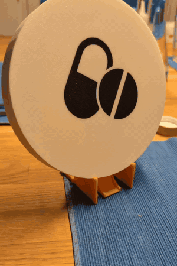
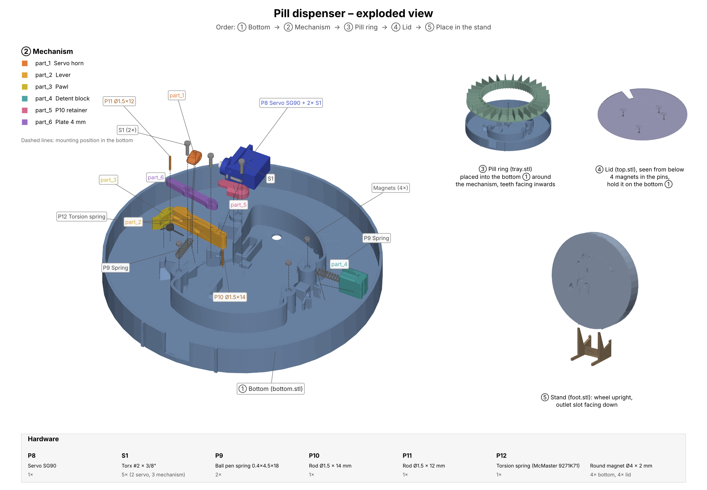

# PillDispenser

A battery-powered, 3D-printed automatic pill dispenser controlled by [Home Assistant](https://www.home-assistant.io/).

> Based on the mechanical design of [Shaztech/Pilldispenser](https://github.com/Shaztech/Pilldispenser), modified and combined with battery-powered ESP32 firmware and a Home Assistant integration.

The device is built around a Seeed Studio XIAO ESP32-S3 and spends almost all of its time in deep sleep. It wakes up once or twice a day, reads its configuration (enabled/disabled, dispense time) from Home Assistant and drops one pill at the configured time by driving a small servo.

> **Disclaimer:** This is a hobby project, not a medical device. There is no guarantee that a pill is dispensed on time or at all. Don't rely on it for medication where a missed or double dose is dangerous.

## Features

- Dispenses one pill per day at a time set in Home Assistant
- Can be switched on and off from Home Assistant (e.g. from your phone)
- Optional: dispense time follows the next alarm on your phone (+30 min) via a [Home Assistant automation](homeassistant/README.md#automatically-following-the-phones-next-alarm)
- Runs for a long time on a single 3000 mAh LiPo: about 14 µA in deep sleep, ~32 µA on average when waking once a day (see [power consumption](docs/power-consumption.md))
- Keeps the last known configuration if Home Assistant is unreachable. Without WiFi it doesn't dispense and retries every hour (see [failure handling](docs/software.md#failure-handling))
- Fully 3D-printable housing and mechanism, plus a few cheap standard parts

## How it works

1. The device wakes up from deep sleep, connects to WiFi and gets the current time via NTP.
2. It reads `input_boolean.pill_dispense_enabled` and `input_datetime.pill_dispense_time` from Home Assistant.
3. If this was a dispense wakeup and dispensing is enabled, it switches WiFi off, powers the servo through a MOSFET and turns the pill ring by one slot.
4. It goes back to deep sleep until the next dispense time or the daily configuration check at 06:00, whichever comes first.

Details, including a sequence diagram: [docs/software.md](docs/software.md).

## Getting started

1. **Print and assemble the hardware:** [hardware/README.md](hardware/README.md)
2. **Wire the electronics:** [docs/wiring.md](docs/wiring.md)
3. **Create the Home Assistant helpers:** [homeassistant/README.md](homeassistant/README.md)
4. **Configure, build and flash the firmware:** [firmware/README.md](firmware/README.md)

## Repository layout

| Path | Contents |
| ---- | -------- |
| [`firmware/`](firmware/) | Arduino sketch for the XIAO ESP32-S3 |
| [`hardware/`](hardware/) | STL files, parts list, exploded-view render script |
| [`homeassistant/`](homeassistant/) | Home Assistant helper setup and next-alarm automation |
| [`docs/`](docs/) | Wiring, software flow, power consumption, images |

## Credits

The mechanical design is based on [Shaztech/Pilldispenser](https://github.com/Shaztech/Pilldispenser). The STL files in this repository are modified versions of that design.

## License

[MIT](LICENSE)
