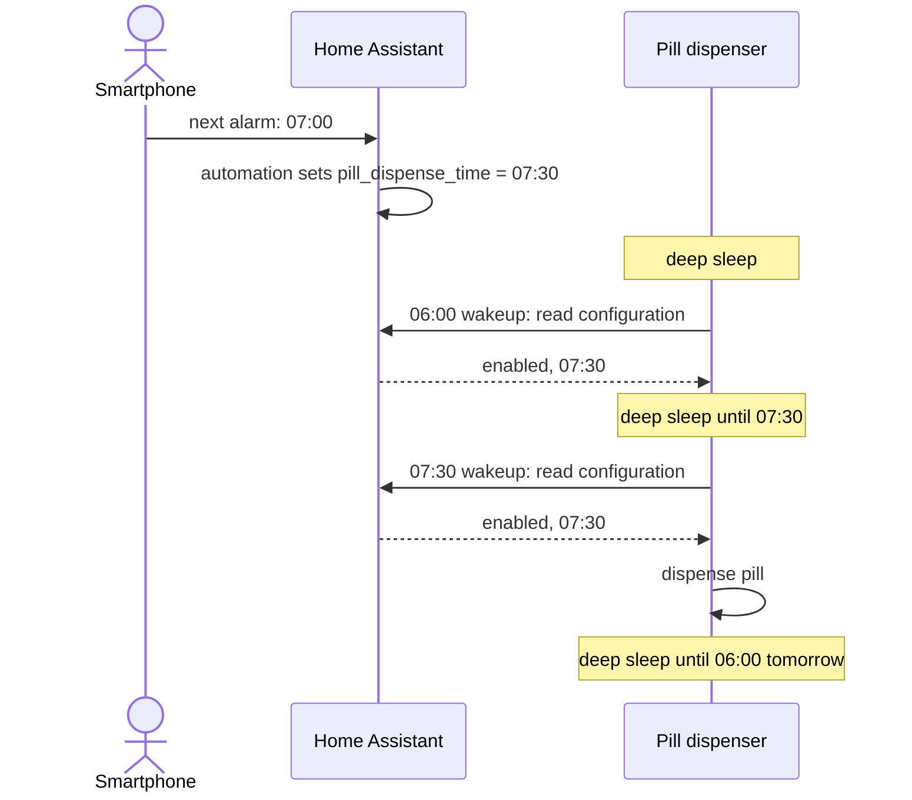
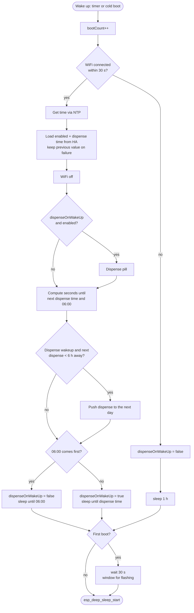

# How the software works

The firmware runs once per wakeup. Everything happens in `setup()` in [`pill_dispenser.ino`](../firmware/pill_dispenser/pill_dispenser.ino), and every run ends in deep sleep. The device is unreachable while it sleeps, so Home Assistant never pushes anything to it. The dispenser always **pulls** its configuration when it wakes up.

## Sequence: a typical day

The phone reports its next alarm to Home Assistant, and an automation sets the dispense time to 30 minutes after that alarm (see [homeassistant/README.md](../homeassistant/README.md)). The dispenser only picks the change up the next time it wakes up.

## Flowchart: one wakeup

## State across deep sleep

Variables marked `RTC_DATA_ATTR` live in RTC memory. They survive deep sleep but are reset on a cold boot (power switch, reset button, flashing):

| Variable | Cold-boot value | Meaning |
| -------- | --------------- | ------- |
| `bootCount` | `0` | Number of wakeups since the last cold boot. `1` triggers the 30 s flash window |
| `dispenseOnWakeUp` | `true` | Whether the current wakeup is a dispense wakeup. `true` on cold boot, so **powering on dispenses a pill immediately** |
| `pillDispenseTime` | `08:30:00` | Last time loaded from Home Assistant |
| `pillDispenseEnabled` | `true` | Last enabled state loaded from Home Assistant |

## Failure handling

| Situation | Behaviour |
| --------- | --------- |
| WiFi not connected after 60 × 500 ms | Sleep 1 h, then try again **without** dispensing. A dispense wakeup that hits a WiFi failure skips that pill |
| Home Assistant unreachable or invalid response | Keep the last known value from RTC memory |
| RTC timer wakes up early | Covered by the 6 h double-dispense guard |
| Dispense time changed in Home Assistant | Not fully covered: the 6 h guard only applies to the wakeup right after a dispense, not to later configuration wakeups. See [when changes take effect](../homeassistant/README.md#when-changes-take-effect) |
