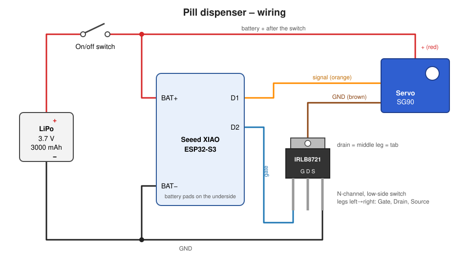

# Wiring

## Connections

| From | To | Notes |
| ---- | -- | ----- |
| Battery + | On/off switch → XIAO `BAT+` pad | Battery pads are on the underside of the XIAO. The XIAO charges the LiPo over USB-C |
| Battery − | XIAO `BAT−` pad, MOSFET source | Common ground |
| XIAO `D1` | Servo signal (orange) | PWM, 500–2400 µs pulse width |
| XIAO `D2` | MOSFET gate (left leg) | High while dispensing |
| MOSFET drain (middle leg / tab) | Servo GND (brown) | Low-side switch: the servo only draws current while D2 is high |
| MOSFET source (right leg) | GND | |
| Battery + (after the switch) | Servo + (red) | Servo runs directly from the battery voltage |

The IRLB8721 is a logic-level N-channel MOSFET. It switches fully on at the ESP32's 3.3 V gate voltage. Leg order with the printed side facing you: **Gate, Drain, Source**.

The MOSFET exists for battery life: an idle SG90 still draws several mA, which would empty the battery much faster than the ESP32's 14 µA deep sleep (see [power consumption](power-consumption.md)).

## Optional improvements

The build uses no resistors and works as wired above. If you want to make it more robust:

- A **10 kΩ pull-down** from gate (D2) to GND keeps the servo off while the ESP32 boots or sleeps and D2 is floating.
- A small **gate resistor** (100–220 Ω) between D2 and the gate limits the inrush current into the gate.
