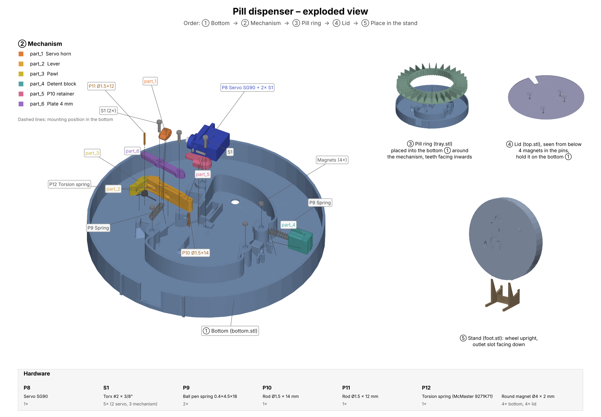

# Hardware

The mechanical design is based on [Shaztech/Pilldispenser](https://github.com/Shaztech/Pilldispenser). The original files were replaced by the modified versions in [`stl/`](stl/).



## Printed parts

| File | Part |
| ---- | ---- |
| `stl/bottom.stl` | Housing / bottom |
| `stl/tray.stl` | Pill ring with ratchet teeth |
| `stl/top.stl` | Lid (pins face into the housing, held by the magnets) |
| `stl/foot.stl` | Stand: the wheel stands upright with the outlet facing down |
| `stl/mechanism/part_1_servo_horn.stl` | Servo horn |
| `stl/mechanism/part_2_lever.stl` | Lever |
| `stl/mechanism/part_3_pawl.stl` | Pawl, pressed against the pill ring by the torsion spring |
| `stl/mechanism/part_4_detent_block.stl` | Detent block |
| `stl/mechanism/part_5_p10_retainer.stl` | Retainer for rod P10 |
| `stl/mechanism/part_6_plate.stl` | Plate (4 mm) |

<!-- TODO: print settings (material, layer height, infill, supports, orientation) -->

## Other parts

- P8 - SG90 Servo 180° PWM Analog (blue type is fine) [1x per tray], fixed with 2x S1
- Round magnets Ø4 x 2mm [4x bottom, 4x lid] - [bought here](https://www.ebay.de/itm/256857279655?var=557385005242)
- P9 - Ball pen springs (0.4x4.5x18mm) [2x per tray: one under the lever (part_2), one behind part_4] - [bought here](https://de.aliexpress.com/item/1005004899133236.html)
- S1 - Torx Screws #2 x 3/8" - McMaster #99512A159 [5x per tray: 2x servo, 2x part_6/part_2, 1x part_5]
- P10 - Ø1.5mm x 14mm rod (I used Aluminium TIG rod, you can use anything that fits) [1x per tray] - [bought here](https://www.amazon.de/dp/B0D2V6WVT4)
- P11 - Ø1.5mm x 12mm rod (I used Aluminium TIG rod, you can use anything that fits) [1x per tray] - [bought here](https://www.amazon.de/dp/B0D2V6WVT4)
- P12 - Torsion spring - McMaster #9271K71 [1x per tray], on P11, presses part_3 against the pill ring

## Electronics

Not shown in the exploded view. Wiring: [docs/wiring.md](../docs/wiring.md).

- Seeed Studio XIAO ESP32S3 (dual-core 2.4 GHz, Wi-Fi, BLE 5.0, battery charging supported) [1x] - [bought here](https://www.ebay.de/itm/276152913715)
- LiPo battery 3.7 V, 3000 mAh, approx. 65 x 35 x 20 mm [1x]
- IRLB8721 MOSFET (switches the servo power) [1x]
- On/off switch [1x]

## Assembly

Order: ① bottom → ② mechanism → ③ pill ring → ④ lid → ⑤ place in the stand (see the exploded view). The mechanism positions in the image were derived from a photo of the assembled mechanism and are accurate to about 1–2 mm.

<!-- TODO: step-by-step assembly instructions, servo zero position, how to load pills, number of slots / pill sizes -->

## Regenerating the exploded view

`render_exploded_view.py` renders [`docs/images/exploded_view.png`](../docs/images/exploded_view.png) from the STL files:

```bash
pip install -r hardware/requirements.txt
```

```bash
python3 hardware/render_exploded_view.py
```
